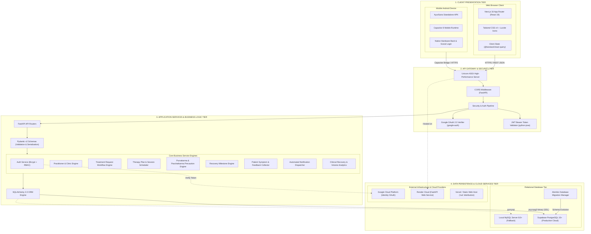
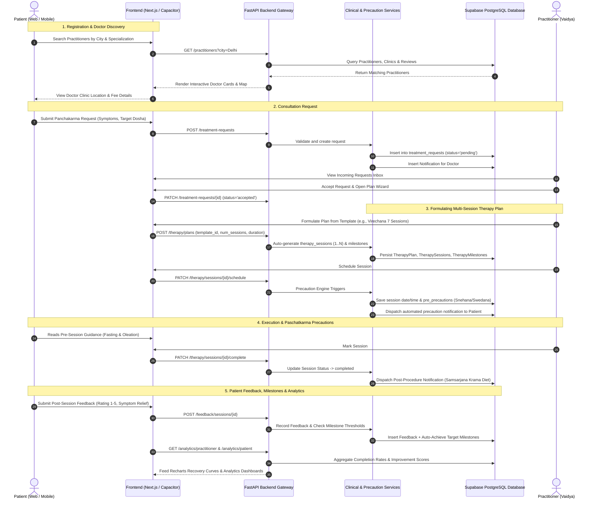
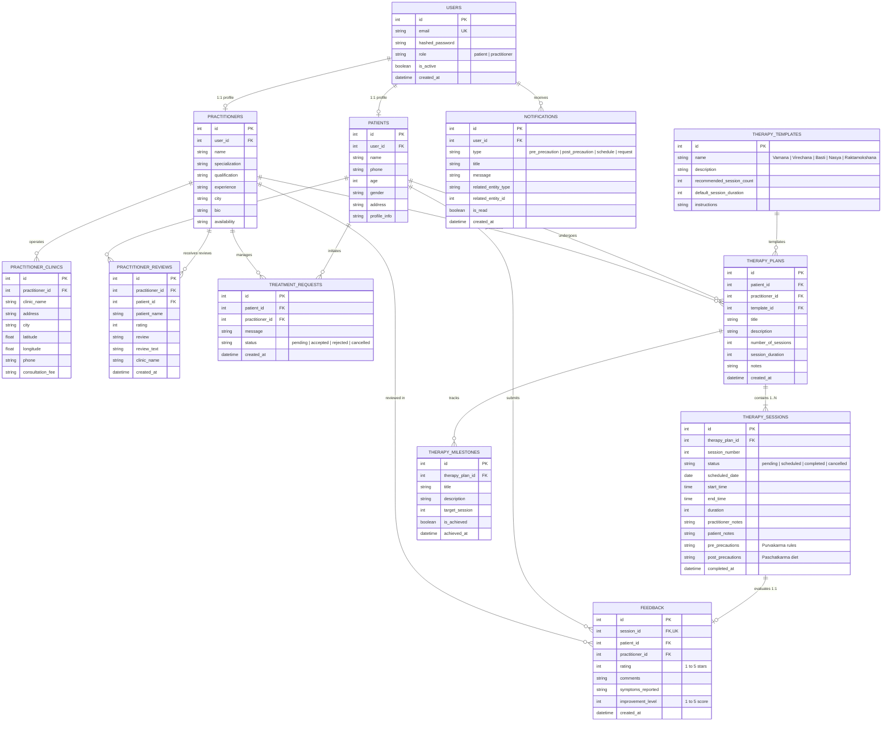
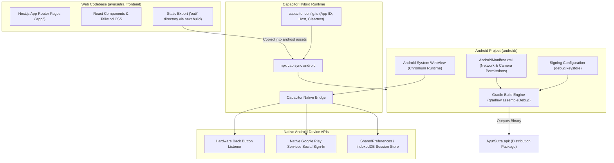
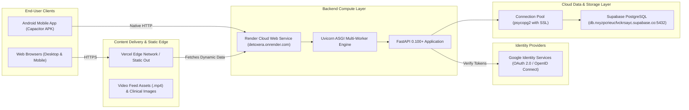

# AyurSutra (DetoxEra) — System Architecture & Detailed Block Diagrams

AyurSutra (DetoxEra) is an enterprise-grade digital therapeutics and clinical scheduling platform engineered specifically for **Panchakarma** management under the **Ministry of Ayush** guidelines (*Problem Statement ID: 25023*). It integrates classical Ayurvedic treatment protocols with modern full-stack web and native Android engineering.

---

## 1. High-Level Multi-Tier Architectural Block Diagram

The platform follows a decoupled, cloud-ready client-server and hybrid mobile architecture across four operational tiers:

---

## 2. Component & Subsystem Decomposition Block Diagram

This diagram breaks down the internal modules across Frontend, Mobile Bridge, Backend Services, and Data Schemas:

```mermaid
flowchart LR
    %% FRONTEND MODULES
    subgraph FE["Frontend Subsystem (Next.js 16)"]
        direction TB
        FE_LAND["Landing & Encyclopedia (/panchakarma)"]
        FE_AUTH["Auth System (/login, /register, Google One-Tap)"]
        
        subgraph PT_PORTAL["Patient Portal"]
            PT_DASH["Dashboard & Recovery Progress"]
            PT_DISC["Doctor Directory & Simulated Map"]
            PT_SESS["Session Timeline & Daily Precautions"]
            PT_FEED["Post-Session Feedback & Symptoms"]
        end
        
        subgraph PR_PORTAL["Practitioner Portal"]
            PR_DASH["Dashboard & Daily Schedule"]
            PR_REQ["Incoming Treatment Requests Inbox"]
            PR_PLAN["Therapy Plan Formulation Wizard"]
            PR_SCHED["Session Scheduler & Precaution Setup"]
            PR_ANAL["Recovery Trajectory Analytics (Recharts)"]
        end
        
        FE_COMP["Interactive Components"]
        FE_MAP["DoctorClinicsMapModal"]
        FE_REEL["PanchakarmaReelsView (Vertical Video)"]
    end

    %% MOBILE BRIDGE
    subgraph MOB["Capacitor 8 Android Bridge"]
        direction TB
        CAP_CONF["capacitor.config.ts"]
        AND_GRADLE["Gradle 8 + android/app/build.gradle"]
        KEYSTORE["Signing Config (debug.keystore)"]
        CAP_PLUG["Capacitor Native Plugins: App BackButton, SocialLogin"]
        APK["AyurSutra Standalone APK (79+ MB)"]
    end

    %% BACKEND SERVICES
    subgraph BE["Backend Core Subsystem (FastAPI)"]
        direction TB
        BE_MAIN["FastAPI Application (app/main.py)"]
        
        subgraph ROUTE_GRP["API Routers (app/api)"]
            R_AUTH["auth.py"]
            R_PRAC["practitioners.py"]
            R_PAT["patients.py"]
            R_REQ["treatment_requests.py"]
            R_THER["therapy.py"]
            R_MILE["milestones.py"]
            R_FEED["feedback.py"]
            R_NOTIF["notifications.py"]
            R_ANAL["analytics.py"]
        end
        
        subgraph SVC_GRP["Service Layer (app/services)"]
            S_AUTH["auth_service.py"]
            S_PRAC["practitioner_service.py"]
            S_THER["therapy_service.py"]
            S_FEED["feedback_service.py"]
            S_NOTIF["notification_service.py"]
            S_ANAL["analytics_service.py"]
        end
    end

    %% INTERCONNECTS
    FE_LAND --> FE_COMP
    FE_COMP --> FE_MAP
    FE_COMP --> FE_REEL
    FE --> MOB
    MOB --> APK
    FE -->|"REST API Calls (lib/api/client.ts)"| BE_MAIN
    BE_MAIN --> ROUTE_GRP
    ROUTE_GRP --> SVC_GRP
```

---

## 3. End-to-End Clinical Lifecycle Workflow

The sequence below illustrates the full lifecycle of a Panchakarma treatment from initial discovery to recovery milestone completion:

---

## 4. Database Entity-Relationship (ER) Architecture

The relational schema comprises **11 interconnected entities** enforcing referential integrity and cascading updates:

---

## 5. Mobile Hybrid Integration Architecture (Capacitor 8)

The diagram below details how the single responsive React/Next.js codebase runs as both a web portal and an offline-resilient native Android application:

---

## 6. Cloud Deployment & Production Topology

The production setup uses a distributed serverless and containerized topology for high availability and zero-maintenance operations:

---

## 7. Key System Metrics & Specifications

| Component | Specification | Description |
| :--- | :--- | :--- |
| **Frontend Framework** | Next.js `16.3.5` + React `19.2.8` | App Router, Server/Client components, Static export (`out`) |
| **Mobile Runtime** | Capacitor `8.5.2` | Android SDK, native plugins, signed debug keystore |
| **Backend Framework** | FastAPI + Uvicorn | Python 3.9+, ASGI async pipeline, automatic OpenAPI Swagger docs |
| **ORM & Migrations** | SQLAlchemy `2.0+` + Alembic | Declarative base, relationship cascades, auto-migration scripts |
| **Database** | PostgreSQL 15+ (Supabase) | Cloud-hosted with SSL; local MySQL fallback available |
| **Security & Auth** | JWT + Bcrypt + Google OAuth 2.0 | Dual-token verification supporting web and mobile client IDs |
| **Clinical Protocols** | Charaka & Sushruta Samhita | Classical Vamana, Virechana, Basti, Nasya, Raktamokshana rules |
